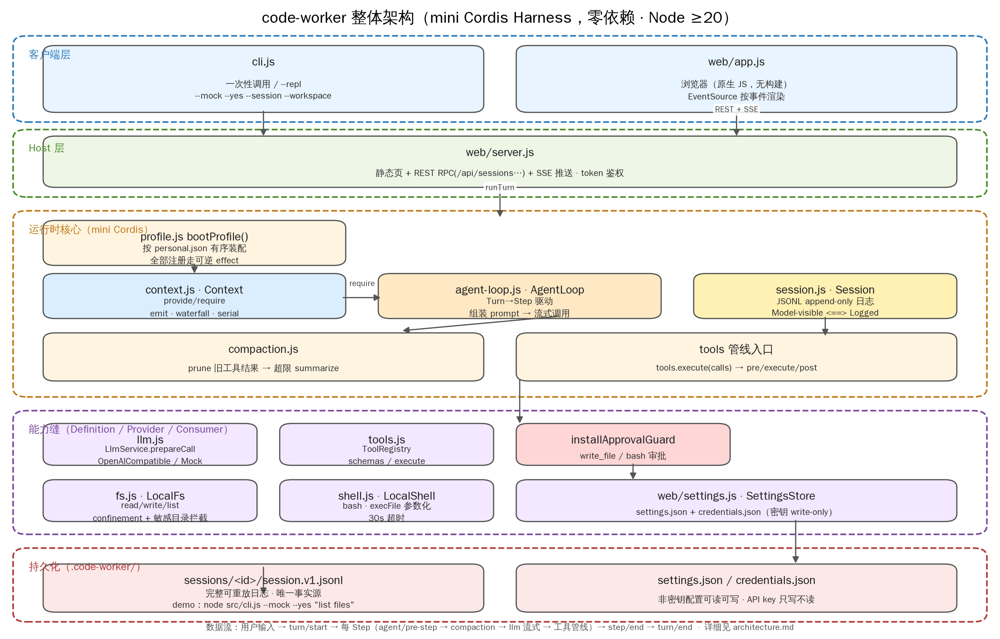
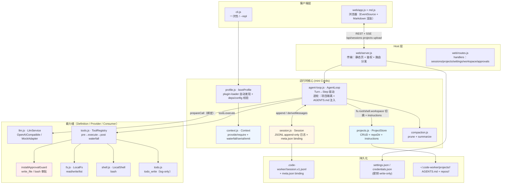

# 整体架构



> PNG 由 `draw_arch.py`（matplotlib）绘制，与下方 Mermaid 图等价；改结构时两处同步。

## 分层

```
┌──────────────────────────────────────────────────────────────┐
│ 客户端层  cli.js（一次性 / --repl）    web/app.js（浏览器）    │
├──────────────────────────────────────────────────────────────┤
│ Host 层   web/server.js（静态页 + RPC + SSE 推送）            │
├──────────────────────────────────────────────────────────────┤
│ 运行时核心  Context · AgentLoop · Session · compaction ·      │
│            profile.bootProfile（装配） · ProjectStore          │
├──────────────────────────────────────────────────────────────┤
│ 能力缝    LlmService · ToolRegistry(+审批守卫) · Fs · Shell   │
│           · todo_write · Projects（隔离根 + AGENTS.md）        │
├──────────────────────────────────────────────────────────────┤
│ 持久化    .code-worker/<id>/session.v1.jsonl (+ meta.json)    │
│           .code-worker/settings.json / credentials.json       │
│           ~/.code-worker/projects/<id>/（项目 + AGENTS.md）    │
└──────────────────────────────────────────────────────────────┘
```

## 架构图



## 一次 Turn 的数据流（项目绑定时多两步）

```
用户输入
  → 项目隔离：fs.root / shell.workspace 指向 repos/<repo>/（记下 prevRoots）
  → turn/start + user/message 落日志
  → system-prompt/assemble (waterfall)，system/message 落日志
      ↑ base prompt = "You are Code Worker…" + 本项目 AGENTS.md（每轮实时重读）
  → 每 Step:
      agent/pre-step (waterfall，可改写/拒绝)
      → compaction（prune 旧工具结果 → 超限则 summarize）
      → llm.prepareCall 流式调用（assistant/chunk 为 live-only）
      → assistant/message 落日志
      → tool/call 落日志 → tools 管线（pre 审批 → execute → post，结果截断）
      → tool/result 落日志 → step/end
  → 无更多 toolCalls 时 turn 结束
  → agent/turn-stopping (serial) → turn/end → 首轮自动生成标题 → 恢复 fs/shell 根
```

每个 Step 内部事件顺序（见 `src/agent-loop.js` 头部注释）：

```
turn/start → claim → snapshot model → assemble prompt+tools
  → agent/pre-step → prepareCall bind → commit system/user
  → freeze → stream → tools pipeline → step/end
  → (more tools owed?) → next step → agent/turn-stopping (serial) → turn/end
```

## 持久化布局

```
.code-worker/                          ← profile.home，相对启动目录
├── <id>/session.v1.jsonl              ← 完整可重放日志（唯一事实源）
├── <id>/meta.json                     ← 项目 binding {projectId, repo}
├── settings.json                      ← 非密钥配置（可读可写）
└── credentials.json                   ← API key（write-only，GET 不回显）

~/.code-worker/projects/               ← CW_PROJECTS_DIR 可改
└── <projectId>/
    ├── project.json                   ← {id, name, createdAt, repos[]}
    ├── AGENTS.md                      ← 项目约定，每轮注入 system prompt
    ├── repos/<repo>/                  ← 会话的 fs/shell 工作根
    ├── docs/ skills/ agents/ outputs/
```

## Web API（`src/web/server.js`）

| 方法 | 路径 | 说明 |
|---|---|---|
| `GET` | `/`、`/*.html\|js\|css` | 静态客户端 `web/`（含 `md.js`） |
| `GET/POST` | `/api/projects` | 列出 / 创建项目 |
| `GET` | `/api/projects/:id` | 项目详情（含 repos + AGENTS.md 内容） |
| `POST` | `/api/projects/:id/repos` | 新增 repo |
| `PUT` | `/api/projects/:id/instructions` | 覆盖写 AGENTS.md |
| `POST` | `/api/upload` | 上传文件（base64，5MB 上限，落 `uploads/`） |
| `GET/PUT` | `/api/workspace` | 查看/切换 workspace（allowlist 校验） |
| `GET/PUT` | `/api/settings`、`/api/settings/test` | 读写设置、连通性测试 |
| `POST` | `/api/approvals` | 逐次审批裁决（per-call 模式） |
| `GET/POST` | `/api/sessions` | 列出 / 创建会话（POST 可带 `projectId`/`repo` binding） |
| `GET` | `/api/sessions/:id` | 详情：`binding`、`title`、`usage`、`todos`、事件、消息投影 |
| `GET` | `/api/sessions/:id/export` | 下载 .jsonl 日志 |
| `GET` | `/api/sessions/:id/stream` | SSE：先重放历史再推 live 事件 |
| `POST` | `/api/sessions/:id/turn` | 提交一轮用户输入 |
| `POST` | `/api/sessions/:id/compact` | 手动触发 compaction |

鉴权：`--token` / `CW_TOKEN`，支持 `?token=`、`x-cw-token`、`Authorization: Bearer` 三种方式；未带 token 请求 `/api/*` 返回 401。

## CLI 参数（`src/cli.js`）

`--mock`（离线） · `--yes`（批准 write/bash） · `--repl` · `--web` · `--port` · `--host` · `--token` · `--workspace <dir>` · `--session <id>` · `--profile` · `--base-url` · `--model` · `--api-key`
