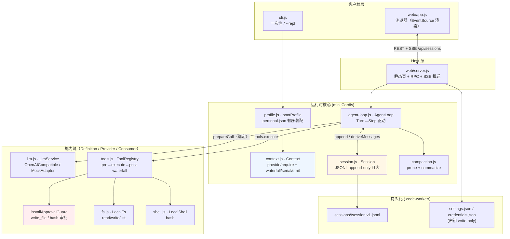

# 整体架构


> PNG 为 Mermaid 图的静态快照（生成脚本未入库）；改结构时以 Mermaid 为准，PNG 按需重绘。

## 分层

```
┌──────────────────────────────────────────────────────────────┐
│ 客户端层  cli.js（一次性 / --repl）    web/app.js（浏览器）    │
├──────────────────────────────────────────────────────────────┤
│ Host 层   web/server.js（静态页 + RPC + SSE 推送）            │
├──────────────────────────────────────────────────────────────┤
│ 运行时核心  Context · AgentLoop · Session · compaction ·      │
│            profile.bootProfile（装配）                         │
├──────────────────────────────────────────────────────────────┤
│ 能力缝    LlmService · ToolRegistry(+审批守卫) · Fs · Shell    │
│          （Definition / Provider / Consumer 三段分离）         │
├──────────────────────────────────────────────────────────────┤
│ 持久化    .code-worker/sessions/<id>/session.v1.jsonl         │
│           .code-worker/settings.json / credentials.json       │
└──────────────────────────────────────────────────────────────┘
```

## 架构图



## 一次 Turn 的数据流

```
用户输入
  → turn/start + user/message 落日志
  → system-prompt/assemble (waterfall)，system/message 落日志
  → 每 Step:
      agent/pre-step (waterfall，可改写/拒绝)
      → compaction（prune 旧工具结果 → 超限则 summarize）
      → llm.prepareCall 流式调用（assistant/chunk 为 live-only）
      → assistant/message 落日志
      → tool/call 落日志 → tools 管线（pre 审批 → execute → post，结果截断）
      → tool/result 落日志 → step/end
  → 无更多 toolCalls 时 turn 结束
```

每个 Step 内部事件顺序（见 `src/agent-loop.js` 头部注释）：

```
turn/start → claim → snapshot model → assemble prompt+tools
  → agent/pre-step → prepareCall bind → commit system/user
  → freeze → stream → tools pipeline → step/end
  → (more tools owed?) → next step → agent/turn-stopping (serial) → turn/end
```

## 持久化布局

```
.code-worker/
├── sessions/<id>/session.v1.jsonl   # 完整可重放日志（唯一事实源）
├── settings.json                    # 非密钥配置（可读可写）
└── credentials.json                 # API key（write-only，GET 不回显）
```

## Web API（`src/web/server.js`）

| 方法 | 路径 | 说明 |
|---|---|---|
| `GET` | `/`、`/*.html\|js\|css` | 静态客户端 `web/` |
| `GET/PUT` | `/api/workspace` | 查看/切换 workspace（allowlist 校验） |
| `GET/PUT` | `/api/settings`、`/api/settings/test` | 读写设置、连通性测试 |
| `POST` | `/api/approvals` | 逐次审批裁决（per-call 模式） |
| `GET/POST` | `/api/sessions` | 列出 / 创建会话 |
| `GET` | `/api/sessions/:id` | 读取会话事件 |
| `GET` | `/api/sessions/:id/stream` | SSE：先重放历史再推 live 事件 |
| `POST` | `/api/sessions/:id/turn` | 提交一轮用户输入 |
| `POST` | `/api/sessions/:id/compact` | 手动触发 compaction |

鉴权：`--token` / `CW_TOKEN`，支持 `?token=`、`x-cw-token`、`Authorization: Bearer` 三种方式；未带 token 请求 `/api/*` 返回 401。

## CLI 参数（`src/cli.js`）

`--mock`（离线） · `--yes`（批准 write/bash） · `--repl` · `--web` · `--port` · `--host` · `--token` · `--workspace <dir>` · `--session <id>` · `--profile` · `--base-url` · `--model` · `--api-key`
